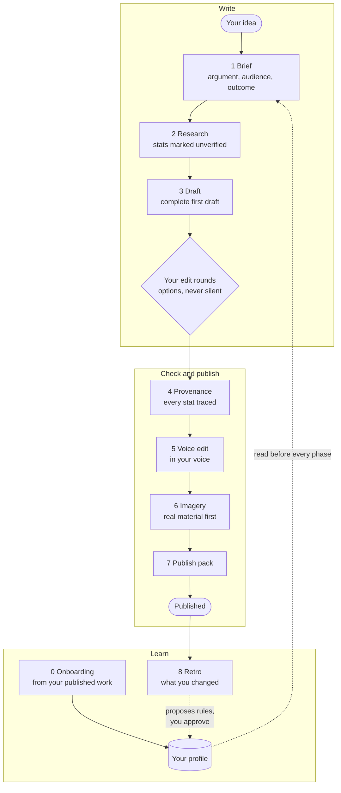
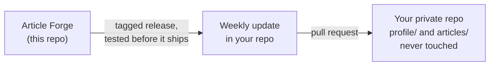

# Article Forge

An idea-to-published article system with Claude at its heart. It takes you from
a rough theme to a published, fully referenced, credible thought-leadership
piece: guided brief, research, drafting in *your* voice, statistic provenance
checks, imagery, platform publishing packs, and a retro loop that learns your
style from what you actually published.

Built from the real production of several published LinkedIn articles,
including the statistic-laundering failures caught along the way: misattributed
headline stats, derived numbers sold as primary research, zombie stats and
publish-day link rot. The process exists so you don't repeat them.

## How it works

One article runs through nine phases. You make every call that matters; Claude
does the legwork and never edits silently.



Your voice lives in your own private repo, and engine improvements reach it as
pull requests you review. They never touch your profile or your articles.



## Quick start

### Claude Code (recommended)

1. Click **Use this template** on GitHub to make your own **private** repo.
   Don't fork: a fork of a public repo is always public, and your profile and
   drafts will live in this repo.
2. Clone it and open Claude Code in the repo root.
3. Say *"Set up my voice profile"*. Claude creates `profile/` and `articles/`
   from the templates, then builds your profile from 2 or 3 pieces you've
   published.
4. Switch on engine updates once (details in [UPDATING.md](UPDATING.md)):
   - **Settings > Actions > General > Workflow permissions**: tick *Allow
     GitHub Actions to create and approve pull requests*, then **Save**.
   - Add a fine-grained token for your repo with **Contents** and **Workflows**
     set to read and write, as the secret `ENGINE_UPDATE_TOKEN`.
   - Check both with `python .claude/skills/article-forge/scripts/check_setup.py`.
5. Then say *"New article: [your theme, thesis or audience]"* and follow the phases.

Optional, for the cover image pipeline: `sudo apt install wkhtmltopdf` and
`pip install pillow`.

### Claude.ai (no terminal)

1. Download the skill ZIP from the latest **Release** of this repo.
2. In Claude.ai, upload it as a skill (the ZIP already has the `article-forge`
   folder at its root).
3. Create a **Project** for your writing. In its first conversation, say *"Set
   up my voice profile"*, then save the generated `voice-profile.md` and
   `context.md` into the Project's knowledge.
4. Work on articles inside that Project, so your profile is always to hand.

Claude.ai is supported on a best-effort basis: the image pipeline, migrations
and update checks need Claude Code.

## Roadmap

Each release is tested before it ships. Ticked items are released; see
[CHANGELOG.md](CHANGELOG.md) for detail.

- [x] **v1.1** First public template: phases 0 to 8 and the cover pipeline
- [x] **v1.2** Foundations: updates can never touch your work; weekly update pull requests
- [x] **v1.3** Prove: every non-negotiable rule has a test
- [x] **v1.3.1** Safe upgrades: release gate, profile migrations, release channels, set-up check
- [x] **v1.3.2** Grounded tests: mutant checks, judge calibration, test-change control
- [ ] **v1.4** Measure: an "AI-ness" scorecard, a detector comparison, and a baseline of how much you edit
- [ ] **v1.5** Learn: your own example passages in every draft; learning from your edit rounds, not only the retro
- [ ] **v1.6** Article types (opinion, how-to, case study and more) and optional style packs
- [ ] **v1.7** Imagery: a provenance and licence record for every image
- [ ] **v1.8** Flow: resume any article where you left off; choose how much Claude does without you

## The phases at a glance

0. **Onboarding**: build your voice profile from what you've published
1. **Brief**: lock argument, audience (asked twice), outcome and positioning
2. **Research**: test the thesis; collect stats, all marked unverified
3. **Draft**: a complete first draft fast, then batched, never-silent edit rounds
4. **Provenance**: every stat traced to its originating report; link map built
5. **Voice edit**: remove machine fingerprints against your profile
6. **Imagery**: real material first; cover pipeline; 3 to 5 iteration rounds
7. **Package**: platform publish pack, companion post, publish sequence
8. **Retro**: paste back the published piece; Claude proposes profile updates for your approval

## What's in the box

```
article-forge/
├── .claude/skills/article-forge/   # THE ENGINE (maintained upstream)
│   ├── SKILL.md                    #   orchestrator: phases and rules
│   ├── references/                 #   one playbook per phase (0 to 8)
│   ├── scripts/                    #   scaffold, migrations, set-up and profile checks, cover renderer
│   ├── migrations/                 #   profile format changes, applied only with your approval
│   ├── assets/templates/           #   profile/ and articles/ starter files
│   ├── evals/                      #   behaviour tests (claude plugin eval)
│   └── .claude-plugin/plugin.json  #   manifest, so Claude Code can test it as a plugin
├── specs/                          # one Gherkin feature file per capability
├── tests/                          # pytest-bdd tests for the code scenarios
├── tools/                          # spec checks, release gate, update tool, mutant and calibration tools
├── .github/workflows/              # ci, release, engine-update, evals
├── CAPABILITIES.md  CHANGELOG.md   # what the engine does; what changed
├── UPDATING.md                     # how updates reach your repo
├── MAINTAINING.md                  # how the engine is changed, tested and released
└── CLAUDE.md                       # Claude Code entry point
```

Your own repo also gets `profile/` (voice profile, context, corpus) and
`articles/` (one folder per article). Onboarding creates them; upstream never
ships them. **Process and profile are separate**: the process is shared and
versioned here; your voice is yours.

## How it is tested

Every capability is a scenario in `specs/`, approved before it is built.
Deterministic scenarios run with pytest-bdd on every push. Claude's behaviour
runs as evals before each release, and each eval is proven able to fail.
Details in [MAINTAINING.md](MAINTAINING.md).

```bash
pip install -r requirements-dev.txt
python tools/check_specs.py     # every scenario has a test, nothing vanished
pytest                          # code scenarios
claude plugin eval .claude/skills/article-forge --scaffold --allow-tools Bash Write Edit
```

## Contributing

Improvements are welcome. Open an **Engine idea** issue with the story and its
scenarios, or a pull request that starts with a scenario in `specs/`. Never
include anything from your own `profile/` or `articles/`.

## Licence

MIT: see [LICENSE](LICENSE).
